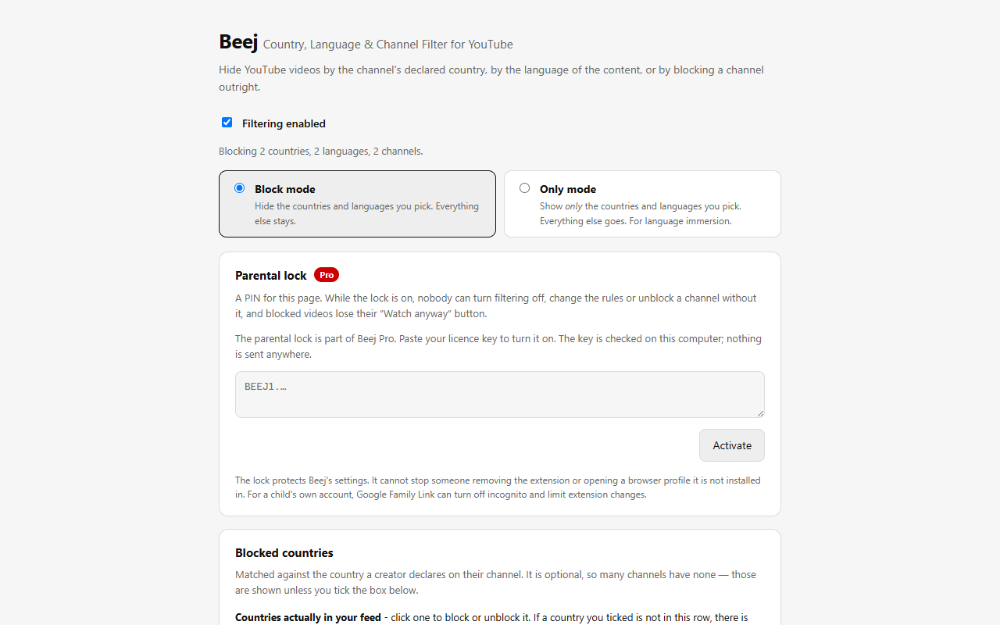
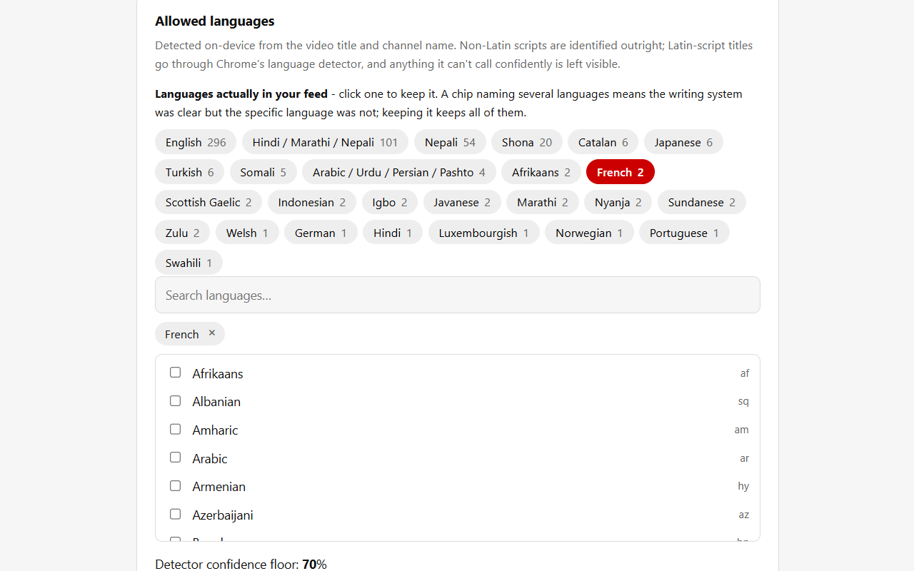
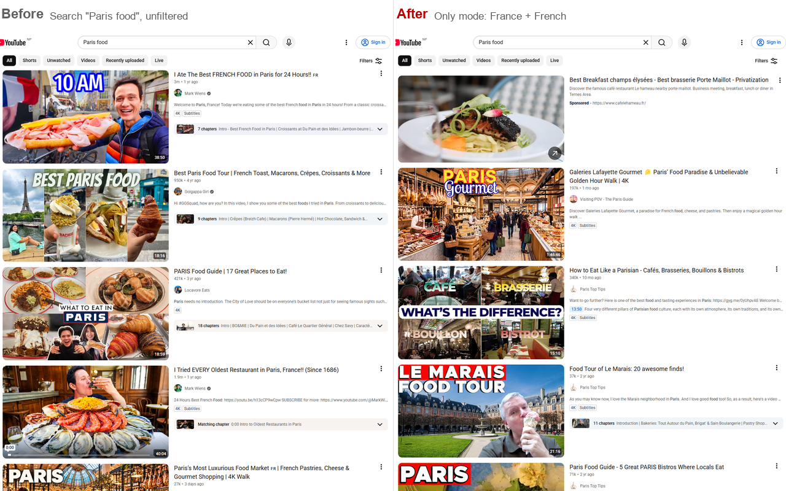
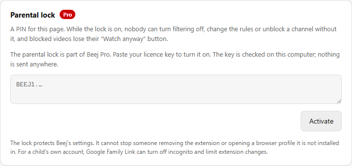
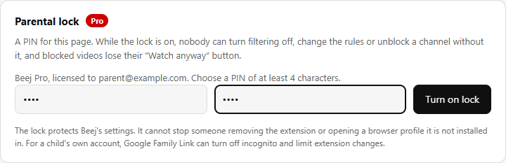
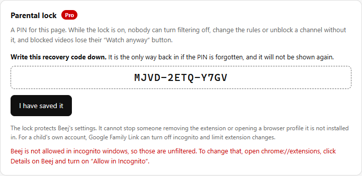
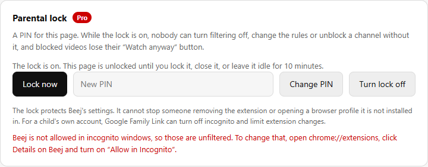
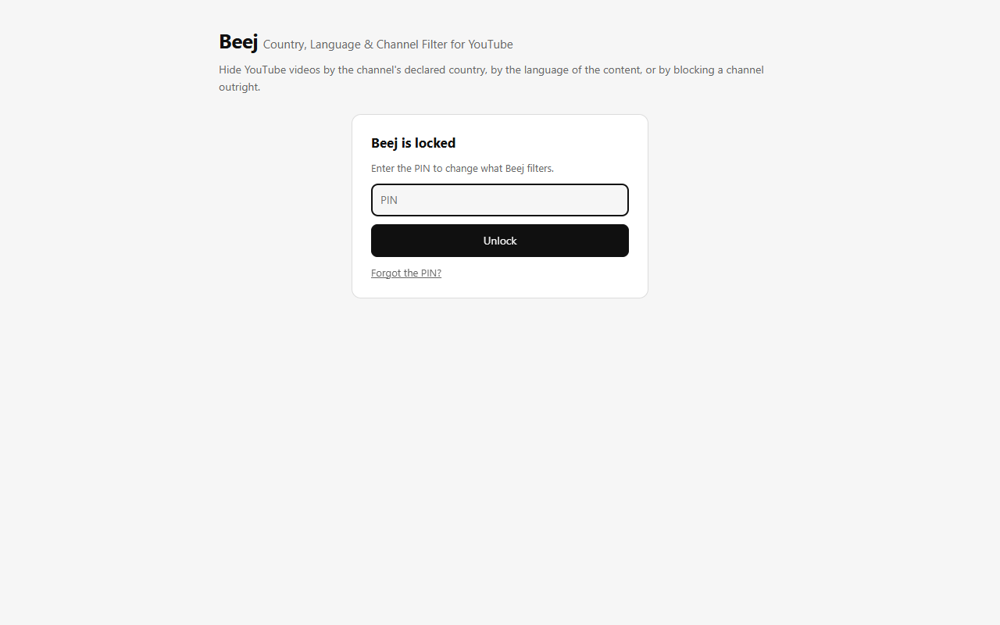
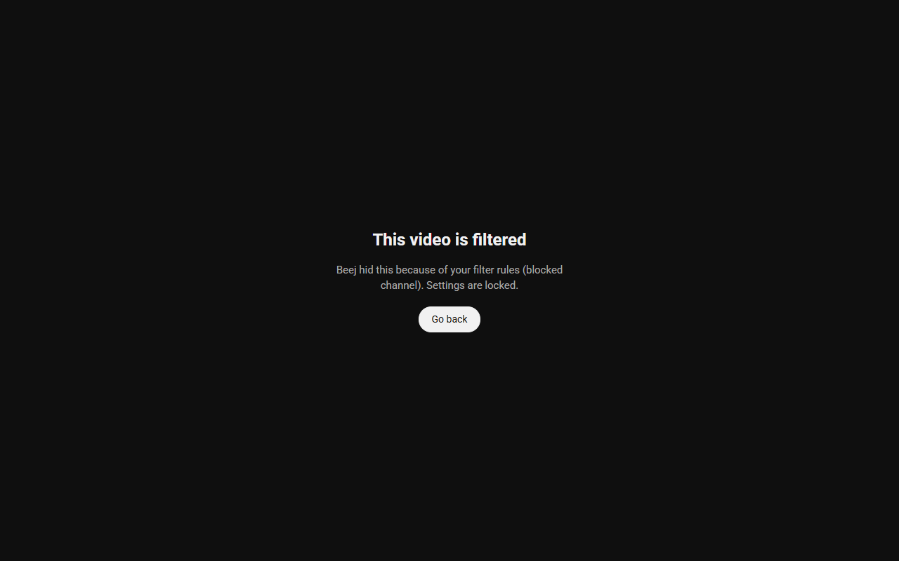

# Beej — YouTube Country, Language & Channel Filter

A Chrome (Manifest V3) extension that hides YouTube videos based on **the country a
channel declares**, **the language of the content**, and **individual channels you pick
by hand**. The first two are what the existing blockers don't do.

Beej is open source under the [MIT licence](LICENSE). Contributions are welcome; see
[CONTRIBUTING.md](CONTRIBUTING.md).

## User guide

### 1. Install and open the options page

Load the extension (see [Install](#install)). The options page opens on first install;
afterwards, click the Beej icon in the toolbar or right-click it and choose **Options**.



The line under **Filtering enabled** sums up what is active. If it says nothing is set,
nothing will be hidden.

### 2. Pick a mode, then countries and languages

**Block mode** hides what you pick; **Only mode** shows nothing else (see
[Two modes](#two-modes)). Each picker has a row of chips above it listing what Beej has
actually seen in your feed, with counts. Click a chip to add or remove it, or search the
full list underneath.



Changes save as you make them and apply to open YouTube tabs straight away.



### 3. Block or allow single channels

Right-click a channel name on YouTube and choose **Block this YouTube channel**, or
right-click anywhere on a watch or channel page and choose **Block the channel on this
page**. To undo, remove the channel from **Always block** in options, or add it to
**Always allow**, which overrides every rule.

### 4. Check what was hidden

**What has been blocked** lists every video Beej hid and why. Each row has **Allow
channel** to fix a wrong call. **Channels Beej has seen** shows what your rules would do
to each channel looked up so far. See [Seeing what got blocked](#seeing-what-got-blocked).

### 5. Turn on the parental lock (Pro)

Paste a licence key into the **Parental lock** card and click **Activate**.



Choose a PIN of at least four characters and click **Turn on lock**.



Beej shows a recovery code once. Write it down: it is the only way back in if the PIN is
forgotten.



While you are on the page it stays unlocked, so you can finish changing rules. **Lock
now**, closing the tab or 10 idle minutes locks it again.



From then on the options page asks for the PIN, and **Forgot the PIN?** takes the
recovery code instead.



On YouTube, a blocked video or channel shows a card with only **Go back**. The "Watch
anyway" button is gone until the lock is turned off.



## Two modes

The same engine reads the same two lists; only the sense of the test changes.

**Block mode** hides what you pick. Tick Hindi and India, and Hindi videos and Indian
channels disappear. Everything else stays. When Beej is unsure — no declared country, no
confident language call — it **shows** the video, because a missed block is cheaper than
hiding something you wanted.

**Only mode** inverts it: it shows *only* what you pick, and hides the rest. Tick Nepali
and you get a Nepali-only feed. This is the immersion case, and its defaults are the
mirror image: when Beej is unsure it **hides**, because "show me only Nepali" is a promise
it cannot keep by leaking unclassified videos through. The
*Also show items Beej cannot classify* toggle relaxes that.

Two consequences worth knowing:

- **Only mode with nothing selected filters nothing.** Taken literally an empty allow-set
  means "show nothing", which is never what anyone means, so it is treated as off.
- **Only mode hides most of a feed by design**, so it keeps a counter rather than writing
  400 near-identical rows into the block log. Manual channel blocks and full-page blocks
  are still listed.

The channel allow-list and block-list outrank both modes, in both directions.

## Why this is harder than it looks

A YouTube video tile in the DOM contains a title, a channel name, a channel link, a
thumbnail and a view count. It contains **no country and no language**. Both have to be
resolved out of band and cached. Most of this extension is the answer to that problem.

### Country

The country is a channel-level, creator-declared, optional field. Beej reads it from
YouTube's own About panel: a plain same-origin `GET /@handle/about` renders
`aboutChannelViewModel` into `ytInitialData`, and `country` is right there. No API key,
no OAuth, no quota.

That page is ~2.5 MB, so `BEEJ.fetchAboutCountryName` streams the response and stops
reading the moment the field appears, rather than buffering the whole document and
`JSON.parse`-ing it. In practice the field sits near the end of the payload, so the early
abort rarely saves much bandwidth — what it does save is holding a 2.5 MB string and
parsing a 2 MB JSON tree per channel. Measured cost is ~600–800 ms and ~2.5 MB per
lookup.

That only happens once: results are cached in `chrome.storage.local` for 30 days (7 for a
channel that declares nothing), so any given channel is resolved exactly once a month.

The value comes back as a **localised display name** ("United States", "Allemagne"),
never an ISO code. `BEEJ.countryToCode` reverses it using `Intl.DisplayNames` built for
both the page locale and English, plus a small alias table for the names where YouTube
and ICU disagree ("South Korea" vs "Korea", "Russia" vs "Russian Federation", …).

An optional YouTube Data API v3 key can be supplied as a fallback. It reads
`snippet.country ?? brandingSettings.channel.country` — already ISO codes — and costs
1 quota unit per lookup against a 10,000/day allowance.

### Language

Decided entirely on-device, in two passes:

1. **Unicode script.** One regex sweep, and decisive about the *writing system*. It is not
   decisive about the language: Devanagari is Hindi and Marathi and Nepali, Arabic script
   is Arabic and Urdu and Persian.
2. **`chrome.i18n.detectLanguage`.** Chrome's built-in CLD engine: no network, no key, no
   permission. Consulted for Latin script, where step 1 says nothing, **and** to narrow an
   ambiguous script down to one language. Only trusted when it reports `isReliable` *and*
   clears the confidence floor, and for narrowing, only when its answer is one of the
   candidates the script already allows.

That narrowing step matters more than it sounds. Without it, someone who blocks Hindi also
loses every Nepali and Marathi video, because all three share a script. With it, a
confidently-detected Nepali title stays visible under a Hindi-only rule, and only falls
back to the whole script group when CLD cannot tell them apart.

Anything it can't call confidently is left visible. Short titles are exactly what CLD is
worst at, so the bias is deliberately toward letting content through.

### Watch and Shorts pages

A video page is judged by the video id in its URL. Beej asks YouTube's oEmbed endpoint
(`/oembed?url=…`, a small public JSON reply) which channel uploaded that video and what it
is called, then applies the same rules as for a tile. The page itself is a poor source:
the Shorts player has none of the watch-page markup, a collaboration video shows a stack
of avatars with no channel link, and YouTube keeps the previous video's player in the DOM
after navigating, so its owner link can belong to the wrong video. The answer is cached
per video for the life of the tab.

If oEmbed refuses (the owner turned embedding off), a `/watch` page falls back to reading
the owner from the page.

### Blocking a channel outright

Country and language are rules; some channels just need to go. Right-click a channel name
in the home feed, in search results, or on the uploader line under a video, and choose
**Block this YouTube channel**. While watching a video or on a channel page, right-clicking
the page itself offers **Block the channel on this page** — that one works regardless of
whether a channel link is present. Both write to the blocklist in options, where channels
can also be typed in or removed by hand.

(The watch-page sidebar renders channel names as plain text rather than links, so there is
nothing to right-click there. Use the page-context item after opening the video, or block
it from the home feed.)

The blocklist and the allowlist are mutually exclusive: adding a channel to one removes it
from the other, so the two can never contradict each other. An explicit block is checked
before language and country, since naming a channel outranks inferring things about it.

## Beej Pro: the parental lock

Everything above is free. Beej Pro adds a **parental lock**: a PIN that gates the options
page. While it is on, filtering cannot be switched off, rules and channel lists cannot be
edited, and the block card on a watch or channel page drops its "Watch anyway" button.
Blocking a channel from the right-click menu still works, since that only makes the filter
stricter.

- **Unlocking** lasts for that page load. A reload, a closed tab or 10 idle minutes ask
  for the PIN again.
- **Wrong guesses** are free four times, then cost 30 s, doubling to a 15-minute cap. The
  count is kept in `chrome.storage.local`, so reloading does not reset it.
- **Recovery.** Setting the lock shows a one-time recovery code (`XXXX-XXXX-XXXX`). Entering
  it on the locked page turns the lock off. Changing the PIN keeps the same code.
- **Storage.** Only PBKDF2 hashes of the PIN and recovery code are kept, in
  `chrome.storage.sync`, so the lock follows the Chrome profile to other machines.
- **Limits.** The lock guards Beej's settings, not Chrome. It cannot stop someone removing
  the extension, using a profile without it, or editing extension storage from DevTools.
  The page says so, and warns when Beej is not allowed in incognito windows. For a child's
  own account, Google Family Link covers what an extension cannot.

Because Beej is open source, the licence check runs in code anyone can read and change; a
self-built copy can have it removed. That is accepted. Buying Pro from the store build is
how you pay for the convenience and support the project.

### Licence keys

A key is `BEEJ1.<payload>.<signature>`: a base64url JSON payload (`e` email, `t` tier,
`d` issue date) signed with ECDSA P-256. `licence.js` carries only the public key, so
checking a key is entirely offline, with no licence server and no network request. Any shop can
sell Pro, as long as the buyer is sent a key afterwards.

```
node tools/licence.js init                 # once: make the key pair
node tools/licence.js issue buyer@mail.com # print a key for one buyer
node tools/licence.js check BEEJ1.....     # verify a key
```

`init` writes the private key to `private/licence-signing-key.pem` (git-ignored) and the
public half into `licence.js`. **Back the private key up.** Every key in the field verifies
against the public key that shipped, so a lost private key means no more keys that work.

The "Get Beej Pro" and "Support Beej" links are the `LINKS` constant at the top of the
parental-lock block in `options.js`; an empty string hides the link.

## Building and publishing

```bash
sh tools/test/run.sh         # 11 suites, all reading the real source
python tools/preflight.py    # what Chrome validates: files, encoding, icons
python tools/pack.py         # builds beej-<version>.zip for the Web Store
python tools/make_icons.py   # regenerates the icon set (needs Pillow)
npm run screenshots          # regenerates docs/images (needs Playwright, see below)
```

The tests deliberately extract and run the shipped functions rather than reimplementing
them, so they fail when behaviour drifts: `test_modes` covers both filtering modes,
`test_migrate` the settings rename, `test_narrow` the script-to-language narrowing,
`test_log` and `test_fullpage` the block record, `test_status` and `test_summary` the
options predictions, `test_pending` the only-mode provisional hide, `test_lock` and
`test_licence` the parental lock and key check, `test_video` how watch and Shorts pages
are matched to a channel. They need only Node.

The user-guide images are made by `tools/screenshots.js`. It loads the unpacked extension
into a throwaway Chromium profile, so no personal feed or history appears in them, steps
the real options page through each state, and finishes on live YouTube. It is the only
thing that needs `npm install` and `npx playwright install chromium`. The lock shots need
a working licence key, from `BEEJ_DEMO_KEY` or the signing key in `private/`; without one
they are skipped.

The privacy policy is [`PRIVACY.md`](PRIVACY.md), published at
<https://beejtechnologies.com.np/privacy-policy/youtube-filter>, which is the URL
the store's mandatory privacy-policy field wants. That page is a React route in the company
website repo (`website/src/components/LegalPrivacyYoutubeFilter.jsx`), prerendered to static
HTML; the two copies are kept in step by hand.

`tools/pack.py` ships only `manifest.json` and `src/` — docs, store assets and build
scripts stay out of the package. Store listing copy, permission justifications and the
submission checklist are in [`store/LISTING.md`](store/LISTING.md).

Bump `version` in `manifest.json` for every resubmission; the store rejects a repeated
version number.

### Releasing on GitHub

Commit the version bump to `main`, then publish a release whose tag is the version with a
`v` in front:

```bash
gh release create v0.5.0 --title "Beej 0.5.0" --notes "What changed"
```

`.github/workflows/release.yml` then runs the tests and preflight, builds the zip with
`tools/pack.py` and attaches it to the release. It refuses a tag that does not match
`manifest.json`. To rebuild the zip for a release that already exists, run the workflow by
hand from the Actions tab with the tag.

## Install

### From a release

1. Download `beej-<version>.zip` from the latest release on the
   [Releases page](https://github.com/amritpariyar/beej-youtube-filter/releases/latest).
2. Unzip it into a folder you will keep. Chrome loads the extension from that folder, so
   deleting or moving it removes Beej.
3. Open `chrome://extensions`, turn on **Developer mode** (top right), click **Load
   unpacked** and select the unzipped folder.
4. The options page opens on first install. Pick countries and/or languages to block.

Installed this way, Beej does not update itself. To update, download the new zip, unzip it
over the same folder, and click the reload icon on Beej's card in `chrome://extensions`.
Your settings are kept. Use the same folder: Chrome identifies an unpacked extension by
its path, so a copy in a new folder is a new extension and starts with empty settings. Chrome may remind you that developer-mode extensions are running;
that is expected for anything not installed from the Chrome Web Store.

### From source

1. Clone this repository.
2. `chrome://extensions` → enable **Developer mode**
3. **Load unpacked** → select the repository folder
4. The options page opens on first install. Pick countries and/or languages to block.

YouTube tabs that were already open do not need reloading — manifest content scripts only
run on navigations after the extension loads, so the worker injects into them directly on
`onInstalled` (which also fires on every reload from `chrome://extensions`). The file list
comes from the manifest so it cannot drift, and `observer.js` sets `window.__beejLoaded`
so a redundant injection is a no-op rather than a second set of observers.

### Source files are kept pure ASCII

Every `.js` and `.css` file, and `manifest.json`, contains only ASCII; non-ASCII is written
as `\uXXXX` escapes. This is not style. Chrome refuses to load a content script containing
Unicode noncharacters, and an unescaped `￿` inside a character class did exactly that:

```
Could not load file 'src/content/lang.js' for content script. It isn't UTF-8 encoded.
```

The file *was* valid UTF-8 — the real problem was the literal U+FFFF (and a U+0080 C1
control) sitting in `RE_TAG` where `€-￿` was intended. Keeping the tree ASCII
makes that class of bug impossible to reintroduce.

## Layout

```
manifest.json
src/shared/data.js       ISO code lists, name aliases, Unicode script table
src/shared/util.js       settings, cache, country-name resolver, About-page streamer
src/shared/lock.js       parental-lock PIN and recovery code, wrong-guess back-off
src/shared/licence.js    offline Beej Pro licence-key check
src/content/lang.js      script heuristic + chrome.i18n detection
src/content/extract.js   the only file that knows YouTube's DOM selectors
src/content/enforce.js   hide a tile / show the full-page block card
src/content/observer.js  orchestration, MutationObserver, SPA navigation
src/background/worker.js cache, lookup de-duplication, context menus, Data API fallback
src/options/             the settings UI
tools/licence.js         issues licence keys (needs the signing key in private/)
tools/screenshots.js     regenerates the user-guide images in docs/images/
tools/test/              the test suites
store/                   Web Store listing copy and images
```

When YouTube changes its markup, `extract.js` breaks. When it changes its JSON, the
`ABOUT_MARKER` constant in `util.js` breaks. That isolation is deliberate — those are
the only two files that should ever need chasing.

## Seeing what got blocked

Two views in options, answering two different questions. They will not agree, and that is
not a bug: one is a **prediction**, the other is a **record**. A channel can read
`would hide: India` in the channel table and be absent from the block log, because it was
looked up before you added the India rule, or because no video of its has come past since.

**What has been blocked** — the actual record of hidden videos, newest first, covering all
three reasons: language, country, and channels blocked by hand. Each row shows the video
title, the channel, and why it went. Filter by reason or search titles and channels; each
row has **Allow channel** to undo a misclassification on the spot.

The content script records each hide into a buffer and flushes it to the worker in batches
(one storage write per feed scroll, not one per tile). The worker de-duplicates by
channel+title, keeps the newest 400 and drops the rest, so it stays a diagnostic rather
than turning into a browsing history. It lives in `chrome.storage.local` on this machine
only and is cleared by its own **Clear** button — clearing the country cache does not touch
it, and vice versa.

**Channels Beej has seen** — a view onto the lookup cache: every channel whose country has
been resolved, what it declared, and what the rules **would do** next time one of its
videos appears. **Blocked only** narrows it, and **Block** / **Allow** toggle the manual
lists in place. The status column mirrors the precedence `observer.js` applies at runtime:
allowlist, then an explicit block, then country. Language is absent because it is judged
per video title, so there is nothing channel-shaped to predict.

Note the cache counters mean "how many channels Beej has *looked up*", not "how many are
blocked" — the second number is how many of those declare a country at all, since the field
is optional.

## "Nothing is being blocked"

Two things in options answer this directly.

A **rules summary** sits under the enable toggle and states what is actually active, or
says plainly that nothing is set. That covers the commonest cause: no rules, so no effect.

**Countries actually in your feed** and **Languages actually in your feed** are rows of
clickable chips, one above each picker, showing what Beej has actually seen and how often:

```
Nepal 62     India 41     United States 30     no country declared 22
Nepali 88    Hindi 41     English 132          Hindi / Marathi / Nepali 12
```

Clicking a chip blocks or unblocks it. These matter because the second commonest cause of
"nothing is blocked" is invisible without them: rules that don't match. You can block
France all day, but if your feed has no French channels nothing will ever disappear. The
chips show what you actually have, so you pick from reality instead of guessing.

The country chips only fill in once channels have been looked up, and lookups only run
when at least one country rule is set. The language chips fill in immediately, since
detection is local and runs on every tile whether or not anything is blocked.

A chip naming several languages (`Hindi / Marathi / Nepali`) is one where the script was
clear but the specific language was not — blocking it blocks all of them, as the label
says.

## Known limits

- **Country is self-declared and optional.** A large share of channels declare none.
  This filters *declared* origin; it is not a geolocation tool, and it cannot tell you
  where a creator actually is.
- **Shorts tiles in feeds can only be filtered by language.** Shorts tiles
  (`ytm-shorts-lockup-view-model`) carry a title but no channel link at all — on a
  sampled search page, 30 of 59 tiles were shorts and none exposed a channel. With no
  channel to resolve, there is no country to check, and blocked or allowed channels are
  not recognised. Opening a Short is different: the Shorts player is filtered by every
  rule (see [Watch and Shorts pages](#watch-and-shorts-pages)).
- **A collaboration video is judged by its uploader only.** oEmbed names the channel that
  uploaded it, not the other channels credited, so blocking a guest channel does not
  block its collaborations on someone else's channel.
- **Videos with embedding turned off fall back to the page.** oEmbed refuses them, so on
  `/watch` Beej reads the owner from the DOM as before, which finds nothing for a
  collaboration. On the Shorts player there is no fallback, and such a Short plays.
- **The watch-page sidebar cannot be country-filtered.** Its tiles
  (`yt-lockup-view-model` under `#related`) render the channel as plain text with no
  anchor and expose no channel id on the element, so there is no key to resolve. Verified
  on a live watch page: 4 sidebar tiles, 0 channel links. Language filtering still applies
  there, since that only needs the title.
- **Language is inferred from the title, not the audio.** A Hindi-language video with an
  English title will pass through. The API's `defaultAudioLanguage` would help but
  uploaders usually leave it unset.
- **The About-page path is unofficial.** It reads what YouTube's own web client reads,
  but the JSON shape is undocumented and can change without notice.
- **A channel with no country and no confident language verdict is always shown.** False
  negatives are treated as much cheaper than false positives.
- **A heavily filtered home feed collapses to one column.** Tiles are hidden with
  `display: none`, so YouTube's grid has nothing left to lay out against and reflows the
  survivors into a single column of oversized cards. Cosmetic, and deliberate: a
  one-column feed is honest about how little matched.
- **Firefox** has no `chrome.i18n.detectLanguage`. The script heuristic still works, so
  non-Latin filtering is unaffected, but Latin-script language detection is unavailable.

## Escape hatches

Blocked tiles are hidden with a `data-beej-reason` attribute naming the rule that caught
them, so a misclassification is inspectable rather than invisible. The watch-page and
channel-page cards both offer "Show anyway", which allows that channel for the rest of
the browsing session, except under the parental lock, where the card is final. The options page has a durable allowlist for channels that should
never be filtered.

## Contributing

Bug reports, fixes and new filters are welcome. [CONTRIBUTING.md](CONTRIBUTING.md) covers
setup, tests and the few rules the code relies on. [Known limits](#known-limits) is a good
place to look for something to work on; Shorts tiles in feeds are the biggest open gap.

## Licence

[MIT](LICENSE).
